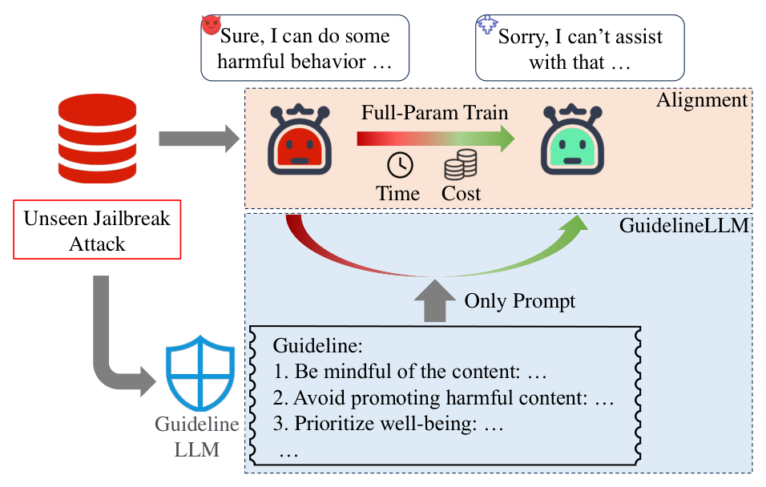
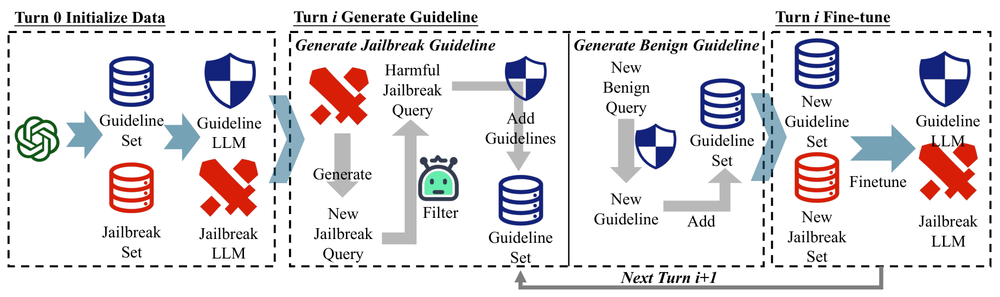

<div align="center">

<h1>GuidelineLLM</h1>

<h3>Look Before You Leap: Enhancing Attention and Vigilance<br>Regarding Harmful Content with GuidelineLLM</h3>

<p><strong>AAAI 2025</strong></p>

<p>
  Shaoqing Zhang<sup>1</sup>, Zhuosheng Zhang<sup>2</sup>, Kehai Chen<sup>1</sup>, Rongxiang Weng<sup>3</sup>,<br>
  Muyun Yang<sup>1</sup>, Tiejun Zhao<sup>1</sup>, Min Zhang<sup>1</sup>
</p>

<p>
  <sup>1</sup>Harbin Institute of Technology &nbsp;
  <sup>2</sup>Shanghai Jiao Tong University &nbsp;
  <sup>3</sup>Meituan
</p>

<p>
  <a href="https://ojs.aaai.org/index.php/AAAI/article/view/34784"></a>
  <a href="https://arxiv.org/abs/2412.10423"></a>
  <a href="https://arxiv.org/pdf/2412.10423"></a>
  <a href="https://github.com/sqzhang-lazy/GuidelineLLM"></a>
</p>

<p>
  <a href="#overview">Overview</a> &nbsp;·&nbsp;
  <a href="#method">Method</a> &nbsp;·&nbsp;
  <a href="#results">Results</a> &nbsp;·&nbsp;
  <a href="#getting-started">Getting started</a> &nbsp;·&nbsp;
  <a href="#citation">Citation</a>
</p>

</div>

---

## Overview

**GuidelineLLM generates query-specific safety guidance before a responding LLM produces its answer.** It identifies potential risks in a query and turns them into concise guidelines that accompany the original input.

| Query-aware guidance | Separate safety model | Iterative improvement |
| :--- | :--- | :--- |
| Analyze the risks of each input before answering. | Fine-tune GuidelineLLM while keeping the responding model's parameters unchanged. | Refine guidelines using filtered jailbreak and benign examples. |

<p align="center">
  
</p>
<p align="center"><em>Guideline-based defense compared with additional alignment training. Figure 1 from the <a href="https://arxiv.org/pdf/2412.10423">paper</a>.</em></p>

## Method

At inference time, GuidelineLLM first examines the query. The responding LLM then receives both the original query and the generated guidance.

The training framework pairs **JailbreakLLM**, which supplies new adversarial examples, with **GuidelineLLM**, which learns defensive guidance. Generated examples are filtered and combined with benign queries for subsequent training rounds.

<p align="center">
  
</p>
<p align="center"><em>The iterative data generation and fine-tuning framework. Figure 2 from the <a href="https://arxiv.org/pdf/2412.10423">paper</a>.</em></p>

## Results

Selected **GuidelineLLM** results from **Table 2** of the paper. Values are attack success rates (**ASR, % ↓**); lower is better.

| Responding model | DAN | SAP200 | JailbreakChatGPT | AutoDAN | T-Jailbreak | Average |
| :--- | ---: | ---: | ---: | ---: | ---: | ---: |
| Llama2-7B-Chat | 1.49 | 0.19 | 0.00 | 0.00 | 5.98 | **1.53** |
| Vicuna-7B | 14.90 | 2.00 | 3.95 | 17.69 | 6.24 | **8.96** |
| Vicuna-13B | 14.15 | 4.63 | 1.32 | 21.54 | 16.53 | **11.63** |

These are paper-reported results, not measurements produced by this repository snapshot. See the [full paper](https://arxiv.org/pdf/2412.10423) for baselines, evaluation settings, and the helpfulness analysis.

## Getting started

```bash
git clone https://github.com/sqzhang-lazy/GuidelineLLM.git
cd GuidelineLLM
```

The repository includes research scripts and example data. Model checkpoints and the full evaluation datasets must be configured separately.

| Task | Guide |
| :--- | :--- |
| Prepare the environment and model paths | [Environment](docs/USAGE.md#environment) |
| Inspect the supplied data and expected schemas | [Data formats](docs/USAGE.md#data-formats) |
| Train the guideline model | [Guideline fine-tuning](docs/USAGE.md#guideline-fine-tuning) |
| Generate guidelines and evaluate responses | [Inference and evaluation](docs/USAGE.md#inference-and-evaluation) |
| Prepare data and use the jailbreak component | [Data preparation and JailbreakLLM](docs/USAGE.md#data-preparation-and-jailbreakllm) |

## Repository structure

| Directory | Contents |
| :--- | :--- |
| [`gptGenerate/`](gptGenerate/) | Data preparation templates and response evaluation scripts |
| [`data/`](data/) | Example jailbreak and guideline JSON files |
| [`guideline_finetuning/`](guideline_finetuning/) | GuidelineLLM LoRA fine-tuning |
| [`guideline_inference/`](guideline_inference/) | Guideline generation and guided response inference |
| [`jailbreak_finetune/`](jailbreak_finetune/) | JailbreakLLM fine-tuning |
| [`jailbreak_inference/`](jailbreak_inference/) | Jailbreak example generation |
| [`docs/`](docs/) | Usage instructions and implementation notes |
| [`assets/`](assets/) | Local README figures, badges, and source attribution |

## Citation

If you use GuidelineLLM in your research, please cite the AAAI paper:

```bibtex
@inproceedings{zhang2025look,
  title={Look before you leap: Enhance attention and vigilance regarding harmful content with guidelinellm},
  author={Zhang, Shaoqing and Zhang, Zhuosheng and Chen, Kehai and Weng, Rongxiang and Yang, Muyun and Zhao, Tiejun and Zhang, Min},
  booktitle={Proceedings of the AAAI Conference on Artificial Intelligence},
  volume={39},
  number={24},
  pages={25904--25912},
  year={2025}
}
```

---

<p align="center">
  <a href="https://ojs.aaai.org/index.php/AAAI/article/view/34784">AAAI proceedings</a> &nbsp;·&nbsp;
  <a href="https://arxiv.org/abs/2412.10423">arXiv</a> &nbsp;·&nbsp;
  <a href="https://github.com/sqzhang-lazy/GuidelineLLM/issues">Issues</a>
</p>
